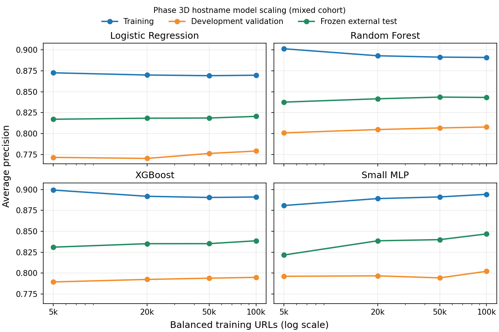

# Phase 3D laptop-bounded phishing URL research

## Dataset quality and split design

| Source | Access, rights and suitability | Use |
| --- | --- | --- |
| UCI PhiUSIIL | The CC BY 4.0 research release supplies 235,795 author-labeled URLs. There are no per-URL observation dates or campaign IDs. This run uses the verified Phase 3B numeric export and excludes its published HTML-derived features. [Prasad and Chandra, UCI 967](https://archive.ics.uci.edu/dataset/967/phiusiil+phishing+url+dataset) | Original training partition only. Its validation and final holdout contributed domain hashes for cross-source exclusion. |
| PhreshPhish v1.0.1 | Published URLs, author labels and observation dates. The authors confirm CC BY 4.0 anti-phishing use, including commercial use with attribution and coverage of the URL and label portions. Release and shard membership were pinned before acquisition. [Dataset card](https://huggingface.co/datasets/phreshphish/phreshphish/blob/eca603e0ecd4f698f8d4d226c088659e72681239/README.md), [author clarification](https://huggingface.co/datasets/phreshphish/phreshphish/discussions/14), [dataset paper](https://arxiv.org/abs/2507.10854) | Acquired 52 train and 17 test shards outside Phase 3C's sampled files. Read URL, date and label columns only. This report attributes and describes the projection and normalization changes. |
| LegitPhish v2 | The publisher lists CC BY 4.0, but its reported total and class counts differ by one. It uses sources shared with UCI and other feeds. Independent observation dates, overlap and upstream reuse conditions are unresolved. [Dataset](https://data.mendeley.com/datasets/hx4m73v2sf/2), [paper](https://doi.org/10.1016/j.dib.2025.111972), [URLhaus terms](https://urlhaus.abuse.ch/api/) | Audited and excluded. |
| CIC-Trap4Phish 2025 | The publisher supplies URLs, HTML, attachments and QR data. The published URL dataset includes multiple malicious classes. URL-level chronology, campaign provenance, overlap with the selected sources, and applicable upstream rights were not verified. [UNB dataset](https://www.unb.ca/cic/datasets/trap4phish2025.html), [UNB reuse policy](https://www.unb.ca/cic/datasets/index.html) | Audited and excluded. |
| Indian banking and payment phishing | The I4C public lookup describes suspect reports and does not establish independently adjudicated research labels, timestamps, representativeness or bulk training rights. [I4C suspect lookup](https://cybercrime.gov.in/Webform/suspect_search_repository.aspx) | No verified corpus used. Non-browsing controls use the existing verified banking/payment/authentication registry and selected documentation or synthetic path shapes. |

The pinned PhreshPhish projection read 620,696 rows. It rejected 6,075 invalid rows and removed 129,349 rows sharing one of 197,285 UCI registrable-domain groups and 169,505 more rows sharing one of 25,156 earlier Phase 3C groups. Deduplication removed 1,324 duplicate URL rows and two conflicting canonical labels. Time and group separation excluded another 35,713 rows. The numeric partitions contain no URLs, raw hostnames, queries, fragments, credentials or HTML. No destination in the source data was visited.

| Fresh PhreshPhish cohort | Observation dates | Phishing | Legitimate | Total rows | Registrable domains |
| --- | --- | ---: | ---: | ---: | ---: |
| Train | 2024-07-02 to 2025-04-20 | 114,896 | 45,120 | 160,016 | 131,152 |
| Validation and threshold calibration | 2025-04-21 to 2025-09-07 | 20,973 | 30,086 | 51,059 | 43,650 |
| Reserved external test | 2025-09-08 to 2025-12-16 | 33,595 | 34,058 | 67,653 | 57,157 |

The chronological cutoffs use the publisher's source train/test boundary. Phase 3D excludes recurring domain hashes across all splits and across both sources. PhreshPhish also groups long normalized registrant stems across suffixes to remove lexical families across the chronological cutoffs. This is a campaign proxy. It misses unrelated names used by the same operator, IP or hosting relationships, and cross-source campaigns that share neither domain nor known lineage. Actual campaign independence remains unverified. The prior UCI holdout and Phase 3C test were not rescored, used to fit models, or used for threshold choices. The reserved PhreshPhish test was scored after the candidate list, model artifacts, validation-selected choices and thresholds were frozen by digest.

## Experimental design and resource policy

Every balanced training set contains one deterministic representative per domain and drops domains with both labels. Nested cohorts used seed 143 and equal class counts. Mixed samples draw half of each class from each source. The available unique training domains were 45,433 phishing and 92,349 legitimate in UCI and 90,528 phishing and 40,606 legitimate in PhreshPhish. This supported the requested 100,000-row level only for the mixture. No row was re-used to manufacture a larger budget.

The four fixed CPU configurations were standardized Logistic Regression, Random Forest with 48 trees and depth 8, CPU histogram XGBoost with 96 trees and depth 3, and a standardized 16-unit MLP capped at 30 epochs. No hyperparameter sweep was performed. The feature and fusion selections use only the development set or the development folds. The held-out set is an external test for UCI-only models and a fresh chronological test from the same release for PhreshPhish-trained ones.

All acquisition, fitting, calibration and scoring runs used the local Windows 11 Lenovo laptop with an Intel Core Ultra 7 155H and 31.4 GiB usable RAM. The guard assigns each suspended worker to a Windows Job Object before it can create children. A two-logical-CPU affinity mask applies to the worker tree and supervisor, with below-normal priority. BLAS, NumExpr and Arrow thread pools were capped, XGBoost was configured for CPU and no GPU or NPU code ran. A named mutex serializes research jobs. The monitor samples every two seconds, stops after 30 continuous seconds of sampled host CPU above 50%, and records load against the 30% target. The recorded jobs set the Windows thresholds in binary units. The published guard uses stricter decimal thresholds of 6 GB target, 7.25 GB active stop and 8 GB job commit ceiling. Every recorded job stayed below these tighter limits. Very short fits can finish before the first CPU sample. Job commit is the worker tree's committed memory, distinct from process RSS. The small supervisor is outside the job commit metric and shares its affinity mask.

## Results

### 3D.1 and 3D.2 scaling and cross-dataset performance

All values are external-test average precision on the same 67,653 URLs. Each training budget is balanced. The 100k mixture has 25,000 phishing and 25,000 legitimate URLs from each source. The pure-source 100k runs would need 50,000 unique eligible domains in each class. UCI and PhreshPhish each fell short in one class.

| Training cohort | URLs | Logistic Regression | Random Forest | XGBoost | MLP |
| --- | ---: | ---: | ---: | ---: | ---: |
| Mixed | 5,000 | 0.8171 | 0.8376 | 0.8310 | 0.8216 |
| UCI | 20,000 | 0.7991 | 0.6646 | 0.7552 | 0.7000 |
| PhreshPhish | 20,000 | 0.8178 | 0.8479 | 0.8443 | 0.8374 |
| Mixed | 20,000 | 0.8183 | 0.8416 | 0.8352 | 0.8386 |
| UCI | 50,000 | 0.8008 | 0.5720 | 0.7660 | 0.6948 |
| PhreshPhish | 50,000 | 0.8164 | 0.8486 | 0.8444 | 0.8450 |
| Mixed | 50,000 | 0.8186 | 0.8436 | 0.8352 | 0.8400 |
| Mixed | 100,000 | 0.8205 | 0.8432 | 0.8386 | 0.8468 |

More data helped the mixed MLP most, increasing external AP by 0.0252 from 5k to 100k. The mixed Random Forest leveled off after 50k and the UCI-only Forest transferred worse as UCI grew from 20k to 50k. These sample-specific comparisons cannot isolate which source properties caused the difference. The MLP reached its iteration cap in all eight base fits.

| 100k mixed candidate | Precision | Recall | F1 | URL false-positive rate | Fit | Model size | p50 inference |
| --- | ---: | ---: | ---: | ---: | ---: | ---: | ---: |
| Logistic Regression | 81.32% | 63.08% | 71.05% | 14.29% | 0.075 s | 1,074 B | 0.305 ms |
| Random Forest | 85.92% | 57.66% | 69.01% | 9.32% | 1.127 s | 396,395 B | 3.439 ms |
| XGBoost | 83.91% | 57.74% | 68.41% | 10.92% | 0.504 s | 20,779 B | 0.380 ms |
| Small MLP | 81.69% | 62.31% | 70.70% | 13.78% | 5.159 s | 7,289 B | 0.462 ms |

These metrics use threshold 0.5. Size is the compressed local research artifact. Inference times are measured over 64 warmed single-row predictions in Python on this laptop, excluding feature parsing and browser costs. The per-model p95, load time, CPU estimate, validation score and confusion counts are in the [aggregate](summary.json).

### 3D.3 feature ablation

PhreshPhish-only Random Forest had the best validation AP for the 20k hostname baseline. All ablations used the same 20k examples. The four extra path features are length, depth, digit count and percent-escape count. The brand ablation adds one locally computed financial-impersonation indicator. URL paths, local registrant/domain digests and other identifiers are never published. The model uses numeric counts and the brand flag.

| Features | AP | Precision | Recall | F1 | URL FPR at 0.5 | Recall at calibrated 1% | Domain FPR 95% upper at 1% | Recall at calibrated 0.1% | Domain FPR 95% upper at 0.1% |
| --- | ---: | ---: | ---: | ---: | ---: | ---: | ---: | ---: | ---: |
| 8 hostname | 0.8479 | 89.93% | 47.58% | 62.24% | 5.26% | 35.97% | 0.8359% | 16.43% | 0.0709% |
| Hostname + path | 0.8984 | 88.06% | 65.70% | 75.26% | 8.79% | 37.57% | 0.9298% | 25.54% | 0.0915% |
| Hostname + path + brand | 0.8986 | 90.70% | 62.03% | 73.68% | 6.27% | 37.39% | 0.9081% | 23.27% | 0.1037% |

The registered selection rule ranked candidates by validation recall at the calibrated 1% target, then validation AP and model size. It selected hostname plus path before opening the test. Its 0.1%-target operating point flagged 18 of 29,166 test domains with legitimate examples, for 0.0617% observed domain FPR and a one-sided exact 95% upper bound of 0.0915%. Calibration used 26,803 legitimate domains. This bound applies to this filtered cohort and assumes domain independence. Shared campaigns, feed lineage and user browsing prevalence make a production 0.1% claim unsupported. The brand flag added little AP and decreased strict-cutoff recall in this paired comparison.

The test contained zero publisher-labeled benign examples with a financial-brand advisory signal. A separate stress check used 18 official-origin URLs and eight documented or synthetic flow paths on verified banking, payment and authentication hosts. The selected path model flagged 4 of 18 origins and 0 of 8 flow paths at 0.5. It flagged 1 of 18 and 0 of 8 at the calibrated 1% operating point, and zero in both categories at the calibrated 0.1% operating point. These controls share registrants and cannot estimate an Indian banking false-positive rate. [Verified registry and fixture sources](../../financial-impersonation.md)

Webpage-content and infrastructure comparisons were skipped. The dataset's URL-level labels do not verify page signals such as form destinations, source rights for usable infrastructure history were not established, and no live phishing pages were fetched or executed.

### 3D.4 fusion and model cost

Fusion used a fixed 20k mixture to limit repeated fits. Three grouped out-of-fold splits provided predictions for model ranking, per-model sigmoid calibration and Logistic Regression stacking. OOF AP selected XGBoost and Random Forest for the two-model blend. Random Forest had the highest validation AP among the four single models at the matched budget. It is the individual reference in this table.

| Matched 20k mixed candidate | Test AP | URL FPR at 0.5 | Recall at calibrated 1% | Test domain FPR 95% upper | Compressed size | p50 inference |
| --- | ---: | ---: | ---: | ---: | ---: | ---: |
| Individual Random Forest | 0.8416 | 14.57% | 35.00% | 0.8142% | 242,460 B | 2.024 ms |
| Two-model weighted average | 0.8414 | 18.51% | 35.00% | 0.8033% | 263,785 B | 4.397 ms |
| Four-model weighted average | 0.8444 | 19.30% | 35.79% | 0.8033% | 271,472 B | 5.713 ms |
| OOF stack | 0.8438 | 18.79% | 35.88% | 0.7997% | 271,349 B | 6.515 ms |

The stack gained 0.88 percentage points of strict recall and took 3.2 times the individual Forest's p50. Knowledge distillation was left out because the measured teacher gain was small. Keep a single model as the next research candidate. The PhreshPhish path Forest is the detection reference. Its size was 324,894 B and p50 was 4.013 ms. The mixed hostname XGBoost is a useful lightweight reference at 20,779 B and 0.380 ms. Test any compressed/exported form and browser runtime independently before considering integration.

### CPU and memory observations

The 38 guarded projection, preparation, fit, fusion and scoring jobs recorded 272.74 worker wall seconds and 137.17 CPU seconds in total, excluding gaps between jobs. Training and fusion jobs accounted for 96.58 wall seconds and 87.89 CPU seconds. The largest training or fusion job peaked at 274.0 MiB of job commit. Projection, preparation and final scoring peaked at 530.3, 523.1 and 318.9 MiB respectively. No experiment stopped for resource use. Across 116 host CPU samples, mean utilization was 8.95% and peak utilization was 25.61%, with zero samples above 30%. The separate chart render overlapped a regression build and recorded one 36.31% host sample. No sustained 50% trigger occurred. CPU sampling is host-wide and cannot attribute unrelated work to the experiment.

### Recommendation

**GO for another local or offline shadow evaluation. NO-GO for live browser shadow testing or any ML-mediated warning or blocking.** First use a separately sourced, rights-cleared chronological cohort with independently labeled Indian financial phishing, legitimate checkout and authentication redirects, and campaign labels. Replay independent date-valid reputation to measure incremental detection lift. Compare the selected single model with CPU XGBoost on the same features and costs. Keep existing production reputation and DNR policies in place.

## Verification

| Suite | Passed | Failed |
| --- | ---: | ---: |
| Spring Boot clean verify | 53 | 0 |
| Extension Node regressions | 23 | 0 |
| Phase 3C projection regression | 1 | 0 |
| Phase 3D partition regressions | 2 | 0 |
| Offline dataset evaluation regressions | 8 | 0 |
| Existing Python research regressions | 7 | 0 |
| Phase 3D Python regressions | 3 | 0 |
| Real Chromium smoke | 1 | 0 |
| **Total** | **98** | **0** |

The separate Windows job smoke confirmed the two-CPU affinity, below-normal priority, child-process commit accounting and the 8,000,000,000-byte limit. Chromium verified authenticated and allowlisted activity, destination blocks before requests reached synthetic host/path/redirect targets, tab-bound exceptions, advisory handling, pause, outage recovery and stale snapshot handling. No production protection code or threshold changed. The history and proposed changes were scanned for credentials and sensitive files. Private numeric partitions and fitted artifacts stayed outside Git.

## Reproduce

Use the CPU [research lock](../../../research/requirements-win-x64-py311.lock), [projection lock](../../../research/phase3c/requirements-projection-win-x64-py311.lock), [plotting lock](../../../research/requirements-plot-win-x64-py311.lock), and npm dependencies from the repository. Preserve the original Phase 3B and Phase 3C private numeric partitions. The dataset scripts accept only the pinned PhreshPhish release and exclude old domains by verified hashes. Create a fresh private run directory outside every Git worktree. With PowerShell from the repository root and an activated locked environment:

~~~powershell
npm ci --prefix evaluation --ignore-scripts
python research/phase3d/resource_guard.py --metrics "$run/projection-final-resources.json" -- python research/phase3d/project.py --uci $phase3bData --phase3c $phase3cData --output "$run/phresh"
python research/phase3d/run.py --run $run --uci $phase3bData --phresh "$run/phresh"
python research/phase3d/resource_guard.py --metrics "$run/publication-resources.json" -- python research/phase3d/publish.py --run $run
~~~

The first two commands acquire data and train models. Do not repeat them for result inspection. The final command verifies the saved calibration and artifact digests and generates an aggregate and learning curve without retraining or rescoring. Use a fresh reserved cohort for future model selection and final evaluation. The exact case plan is [checked in](../../../research/phase3d/plan.json).
