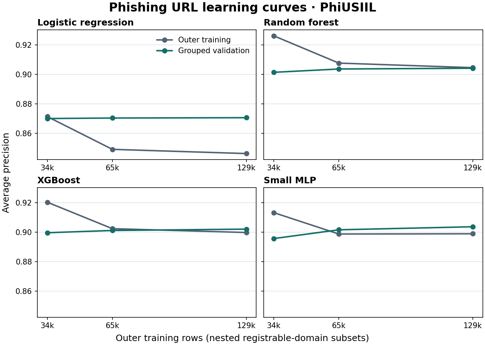
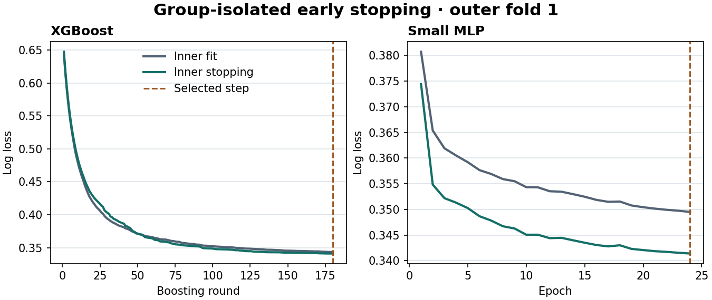

# Phase 3B PhiUSIIL phishing URL experiment

**Random Forest was selected before opening the holdout** by mean average precision across the five training folds. It retained the highest holdout average precision, narrowly ahead of the small MLP. This is a retrospective experiment on one corpus. Production deployment and browser blocking remain **NO-GO**.

## Data and leakage audit

Prasad and Chandra (2024), *PhiUSIIL Phishing URL (Website)*, UCI Machine Learning Repository, DOI `10.1016/j.cose.2023.103545`, CC BY 4.0. ThreatDetection recomputed the existing 14-element lexical vector from the URL and mapped the author label `0` to phishing (experiment positive `1`) and author label `1` to legitimate (experiment negative `0`). The experiment used none of the supplied reputation, corpus statistics, page content, or label-derived features. It never visited a listed URL. [UCI dataset and licensing](https://archive.ics.uci.edu/dataset/967/phiusiil+phishing+url+dataset)

| Partition | Phishing | Legitimate | Rows | Registrable-domain groups |
| --- | ---: | ---: | ---: | ---: |
| Train | 67,270 | 94,269 | 161,539 | 137,851 |
| Validation for threshold calibration | 16,980 | 20,289 | 37,269 | 29,689 |
| Final holdout | 13,330 | 20,291 | 33,621 | 29,745 |

Both the ZIP and CSV matched their pinned SHA-256 digests. Two exports reproduced all three partitions and both manifests byte for byte. The exporter uses the same Phase 3A parser, normalizer, PSL grouping, deduplication, and partition seed, and checks each partition's published class and domain counts. The scorer verified that the holdout had no development domains.

The training-only audit found that **100% of legitimate examples were HTTPS and had zero normalized path length**. In the phishing class, 51.86% were HTTP and 25.19% had a nonroot path. To limit these source shortcuts, the models used only eight numeric hostname features. Scheme, nondefault port, and all four path features were excluded before tuning. Labels, source indicators, domain hashes, raw text, and browsing secrets were never predictors. The greatest single-feature AUC among the retained features was about 0.67, which is compatible with residual corpus bias. Domain separation cannot remove source, campaign, or collection bias.

## Five-fold cross-validation

Five shuffled stratified **grouped** folds used the Phase 3A train partition only. The budget was two configurations per model, or 40 outer CV fits, plus eight smaller learning-curve fits and four final fits. The seed was 37, with stopping seed offset by the outer fold index. Logistic Regression and MLP scaling was fit on the relevant fitting partition only. XGBoost and MLP monitored group-isolated inner stopping data, 12.5% of the outer training domains. Model and hyperparameter selection used outer-fold mean average precision. Final fits reused the median selected round count on all training rows. The independent validation partition was opened for threshold calibration after model choices and artifacts were fixed.

The table reports fold means. Precision, recall, F1 and FPR use a score cutoff of 0.5. PR-AUC is reported as noninterpolated average precision (AP).

| Model | AP ± SD | ROC-AUC | Precision | Recall | F1 | URL FPR |
| --- | ---: | ---: | ---: | ---: | ---: | ---: |
| Logistic Regression | 0.8511 ± 0.0120 | 0.8267 | 93.68% | 64.83% | 76.61% | 3.12% |
| Random Forest | 0.9001 ± 0.0028 | 0.8895 | 94.58% | 70.30% | 80.64% | 2.88% |
| XGBoost | 0.8977 ± 0.0035 | 0.8871 | 95.18% | 69.83% | 80.55% | 2.52% |
| Small MLP | 0.8976 ± 0.0048 | 0.8855 | 94.07% | 71.02% | 80.92% | 3.20% |



The size curves hold outer fold 1's validation domains fixed and use nested training-domain subsets. They are diagnostics for one fold. Random Forest's mean training AP was 0.9051, about 0.005 above its mean outer-validation AP. Its fold-1 gap narrowed from 0.0247 at 25% of training domains to 0.0004 at full size. All four holdout AP scores were 0.010–0.014 below their mean CV AP. MLP's holdout F1 was slightly higher than Random Forest's, and the two holdout AP scores differ by about 0.00027. The differences do not establish a stable model ordering across corpora.



The selected XGBoost configuration reached its 180-round cap in all five folds. The selected MLP recorded best epochs 24, 24, 6, 23, and 24. A cap can end an improving run. The caps and results remained fixed when the holdout was opened.

## Final holdout results

Each frozen model made one predictive pass on the untouched holdout. The scorer reused those scores for each fixed threshold. Confusion matrix order is **TN / FP / FN / TP**.

| Model | AP | ROC-AUC | Precision | Recall | F1 | URL FPR | Confusion matrix |
| --- | ---: | ---: | ---: | ---: | ---: | ---: | --- |
| Logistic Regression | 0.8369 | 0.8201 | 93.33% | 62.69% | 75.00% | 2.94% | 19,694 / 597 / 4,973 / 8,357 |
| Random Forest | 0.8876 | 0.8823 | 94.26% | 68.72% | 79.49% | 2.75% | 19,733 / 558 / 4,169 / 9,161 |
| XGBoost | 0.8850 | 0.8803 | 94.47% | 65.87% | 77.62% | 2.53% | 19,777 / 514 / 4,549 / 8,781 |
| Small MLP | 0.8874 | 0.8812 | 93.46% | 69.38% | 79.64% | 3.19% | 19,644 / 647 / 4,082 / 9,248 |

On this same holdout, the existing financial impersonation baseline issued zero alerts, with 0% recall and 0% FPR. Its registry targeted four Indian financial brands, and the corpus has no verified Indian financial cohort. Reputation and the combined baseline abstained because the corpus has no row observation dates and no time-valid historical snapshots. The experiment therefore cannot quantify a lift over reputation or the combined product. [Phase 3A baseline](../../dataset-evaluation.md#executed-benchmarks)

## Fixed low false-positive operating points

Calibration used maximum scored legitimate-example probability within each of **19,791 negative domains**, a binomial order-statistic cutoff at 5% risk, and conservative tie handling. The holdout had **19,976 domains with legitimate examples**. URL FPR and domain FPR have different denominators. The reported one-sided 95% limits are exact binomial calculations on negative domains and assume independent domains.

| Model | Target domain FPR | Recall | URL FPR | Observed domain FPR | Domain FPR 95% upper |
| --- | ---: | ---: | ---: | ---: | ---: |
| Logistic Regression | 1% | 46.40% | 1.010% | 0.921% | 1.040% |
| Random Forest | 1% | 63.47% | 1.173% | 0.921% | 1.040% |
| XGBoost | 1% | 64.04% | 1.429% | 1.066% | 1.194% |
| Small MLP | 1% | 64.09% | 1.129% | 0.971% | 1.093% |
| Logistic Regression | 0.1% | 29.82% | 0.069% | 0.065% | 0.103% |
| Random Forest | 0.1% | 56.70% | 0.094% | 0.080% | 0.122% |
| XGBoost | 0.1% | 56.60% | 0.138% | 0.125% | 0.175% |
| Small MLP | 0.1% | 54.06% | 0.069% | 0.070% | 0.110% |

The data supported estimating both cutoffs. No observed 95% upper bound was below its corresponding target. At the 0.1% target, Random Forest caught 7,558 phishing URLs and flagged 19 legitimate URLs. Its observed URL FPR was 0.094%, with a 0.122% upper bound on the separate domain-level rate. These measurements do not certify a blocking threshold.

## Cost and frozen artifacts

The development stage took **195.53 s**, including fitting, scoring CV, curve points, serialization, and calibration. CPU fits used up to four tree workers and one BLAS thread. Inference timings use one CPU thread, 256 warmed single-row calls and repeated 1,024-row batches from calibration, with preprocessing included. They exclude hostname parsing, browser startup and browser integration. Compressed sizes describe serialized artifacts.

| Model | Final fit | Artifact bytes | Single p50 / p95 | Batch p50 per row |
| --- | ---: | ---: | ---: | ---: |
| Logistic Regression | 0.11 s | 1,029 | 0.526 / 0.684 ms | 0.79 µs |
| Random Forest | 1.53 s | 2,592,825 | 6.186 / 7.264 ms | 18.94 µs |
| XGBoost | 0.67 s | 99,316 | 0.508 / 0.708 ms | 4.64 µs |
| Small MLP | 18.21 s | 17,669 | 0.548 / 0.881 ms | 4.33 µs |

Environment: Windows x86-64, Python 3.11.9, scikit-learn 1.9.1, XGBoost CPU 3.2.0, NumPy 2.4.6, SciPy 1.17.1, Joblib 1.6.0, Node.js 24.14.1, and Matplotlib 3.10.8. [Full development results](development-report.json) include every configuration, fold and trace. [Frozen holdout results](holdout-report.json) contain exact thresholds, strict-threshold matrices, selected hyperparameters, timings and SHA-256 checksums of all four models. Model files stayed outside Git in the private run directory. Load only trusted artifacts from that run.

## Reproduce without opening the existing holdout again

Install the locked Python CPU environment from [the research guide](../../../research/README.md) and run `npm ci --prefix evaluation --ignore-scripts` from the repository root. Put the original UCI CSV and all numeric partitions in a private folder outside Git. The [Phase 3A guide](../../dataset-evaluation.md#reproduce-locally) gives the official ZIP and pinned digests. Reproducing the prepared bytes or fit checks does not need another predictive pass over the existing holdout.

```powershell
node research/prepare_phiusiil.mjs --input-dir "$run/source" --output-dir "$run/dataset"
.\.venv\Scripts\python.exe research/train_phiusiil.py --development-dir "$run/dataset/development" --output-dir "$run/models"
.\.venv\Scripts\python.exe -m unittest discover -s research
npm test --prefix evaluation
```

The original final scorer is `research/evaluate_phiusiil.py`. It verifies the frozen model digests, reads the holdout only after creating an exclusive marker, and refuses another scoring pass for the same run. Preserve the marker and use a newly reserved holdout for a future evaluation. The chart script takes the aggregate development report and needs only the optional plotting lock.

## Commercial readiness

PhiUSIIL has no per-row dates, verified Indian financial coverage, or representative browsing prevalence. Its hard negatives and phishing sampling differ from one another, so reported precision and FPR cannot be assumed for real traffic. The eight model inputs are available from a hostname at inference time, with the same Punycode and PSL behavior. The Python artifacts have no browser runtime integration or Chrome latency validation. Host-only features also miss attacks that share a legitimate host or differ only in their path.

Next, validate on independently licensed datasets that record observation time and target brand. Include Indian bank, UPI, wallet, legitimate payment handoff, and shared-host hard negatives. Match acquisition and URL granularity across classes, preserve campaign and domain isolation, and reserve a chronological external holdout. Replay dated independent threat snapshots there before comparing model value and choosing a deployment threshold.
