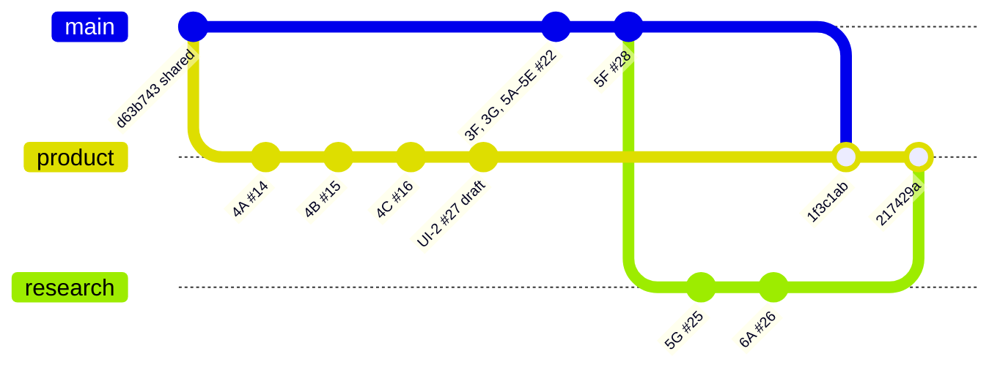

# Phase 6B integration audit

The integration branch combines the UI-2 product head `9661a263`, main `bbbaaff7` and the Phase 6A research head `9908b496`. The common product and research ancestor is `d63b7432`. The merges produced no textual conflicts. Product runtime files match UI-2, and the additional test changes allow the Windows smoke harness to run when PowerShell 7 is unavailable. Research files retain their original paths. Phase 5G and 6A remain research-only.

The product pull requests are stacked 4A → 4B → 4C → UI-2. Research PRs #13, #17–20, #23–26 remain open on their respective preceding branches. PRs #22 and #28 brought research through 5F into main. Earlier Phase 3A–3E work is already in main. PR #21 is recorded as merged through the research ancestry. The integration branch provides a combined review path. Coordinate the final merge order with the owners of the existing stacks to avoid duplicate integration. No pull request has been merged as part of Phase 6B.

The frontend reference comparison and live screen-reader speech pass remain open in [UI-PROGRESS.md](../UI-PROGRESS.md). Keep PR #27 and the integration PR in draft until those acceptance gates are resolved. Phase 5G reports zero eligible independent URL and paired records scored, and Phase 6A reports zero independent visual records. Production ML and visual inference, warnings, blocking, shadow testing and visual telemetry remain disabled pending the established validation decisions.

## Reproducibility

The dashboard's aggregate projector reads pinned Git revisions and produces 16 cohort records plus the Phase 5F grouped comparison. It does not require model artifacts at runtime. Run `node scripts/project-monitor-research.mjs` and compare the resulting `backend/src/main/resources/monitoring/research.json` with Git. Keep datasets and model artifacts in a private directory outside the repository.

Run `node scripts/check-frozen-receipts.mjs <private-experiments-directory>` for read-only SHA-256 checks against the Phase 5G registry and Phase 6A receipts. The check covers published preprocessing and evaluation code at their frozen revisions, reports, historical inputs, model artifacts, visual references and the visual model weights. It does not recompute grouped membership digests. Use the original experiment procedure for those checks. It does not run inference or training.

## Verification and remaining work

On the integration tree, Maven passed 62 tests, the extension passed 29 unit tests, and the evaluation suite passed 8 tests. Direct and secure Windows Chromium smoke runs passed with the responsive matrix. The secure run exercised PowerShell 5.1 setup and PowerShell 7 restart, credential rotation, persistence and deduplication. The sanitized projection matched Git and 54 receipt checks passed. Grouped membership digests remain unverified in this pass.

The repeated loopback benchmark used Chromium 159 on the same Windows 11 Core Ultra 7 155H workstation with 32 GB RAM, 12 synthetic reports, one warm-up and six cold contexts. Median navigation was 97.1 ms, DOMContentLoaded 85.3 ms, dashboard response to first chart frame 28.2 ms, and count settlement 476.3 ms. The frame interval was 16.8 ms at p95, with zero of 294 intervals above 33.4 ms. Initial decoded assets were 144,369 bytes. The prior final UI-2 run recorded 677.7 ms navigation, 437.6 ms DOMContentLoaded and 36.3 ms frame p95. Startup variability across runs limits direct attribution. Raw data, the copied harness and a fresh motion recording are in `C:/Users/kj/threat-detection-experiments/phase-6b-evidence`.

The UI-2 evidence and earlier accessibility and performance measurements are recorded in [UI-PROGRESS.md](../UI-PROGRESS.md). Compare the available screenshots with the original reference when it is supplied and conduct the speech pass on an interactive desktop. Review the private evidence without committing records, credentials, datasets or model binaries.
